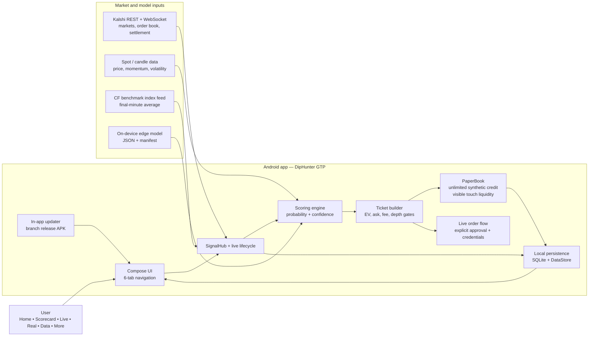
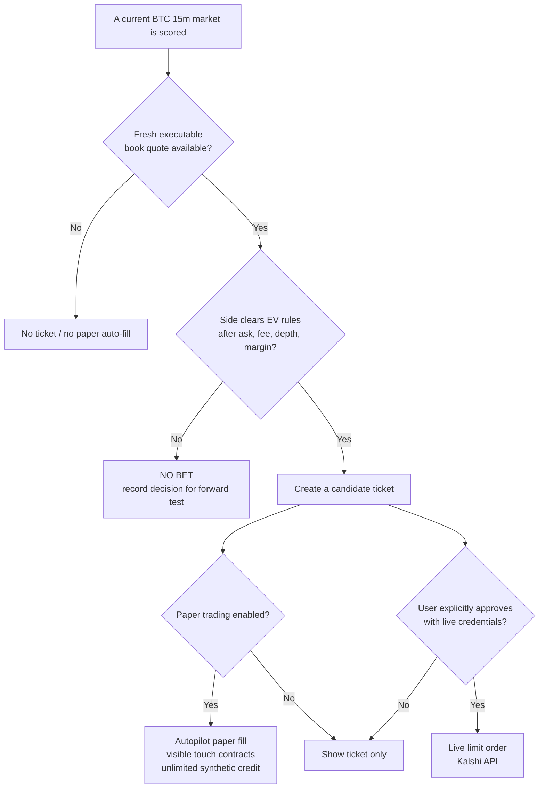
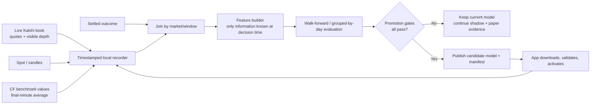
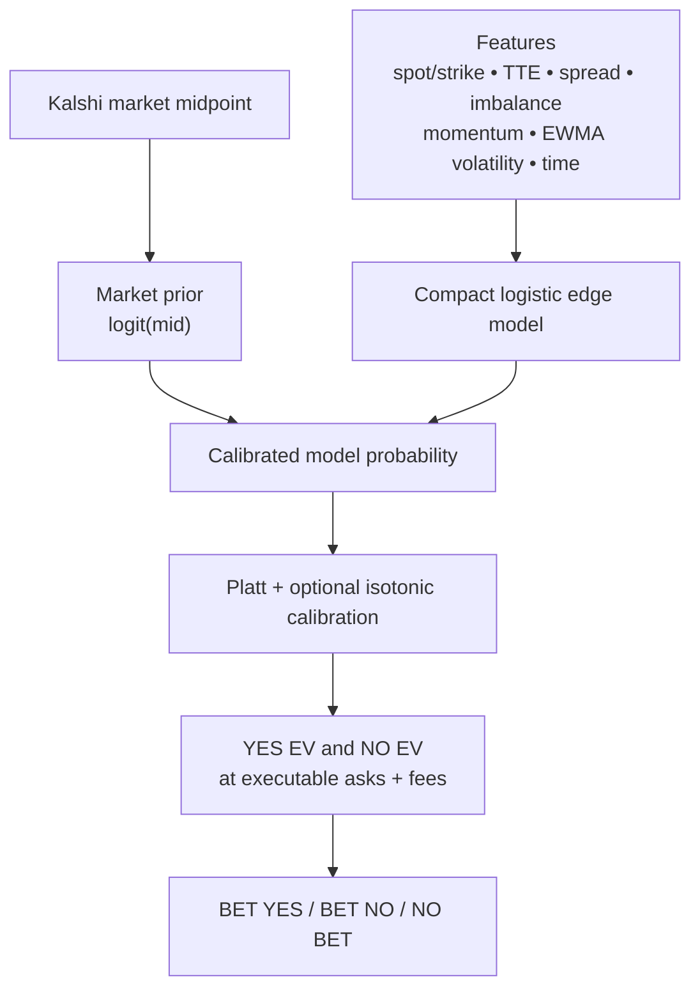
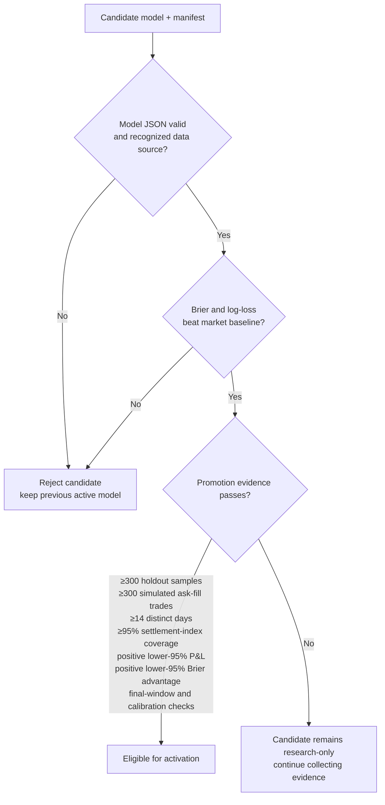
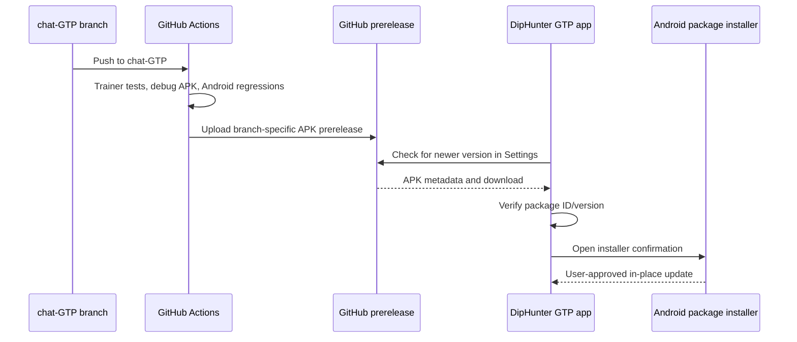
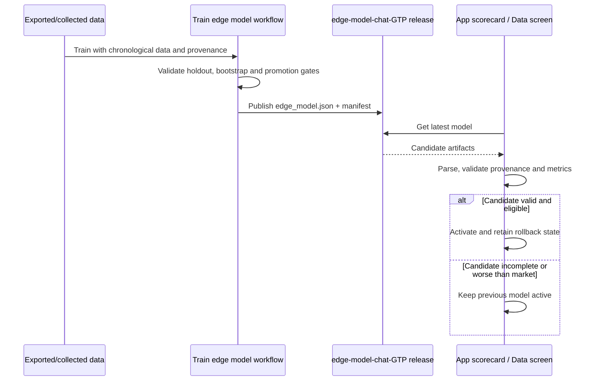
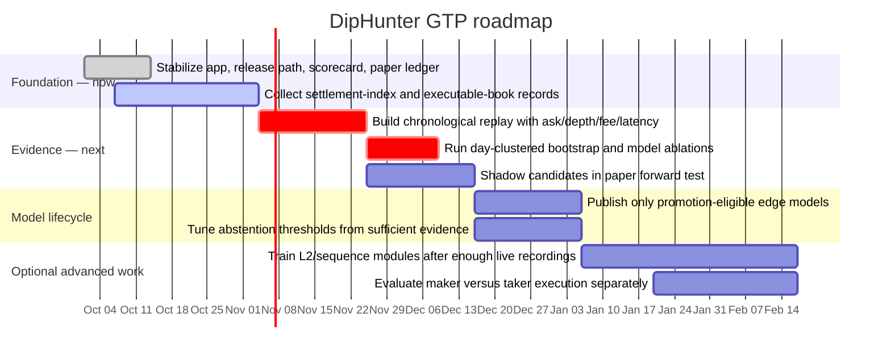
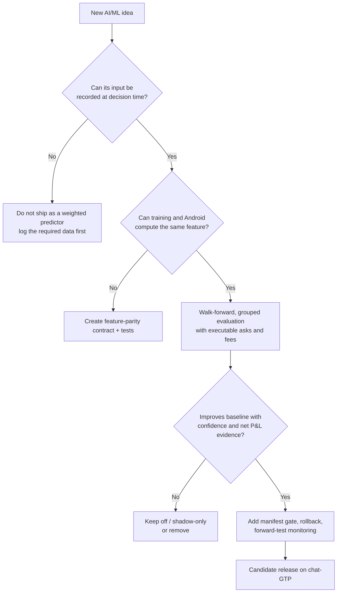

# DipHunter GTP — App, AI/ML, and Roadmap

## One-line product definition

DipHunter GTP is a Bitcoin 15-minute Kalshi market dashboard and decision-support app. It combines live market quotes, spot and settlement-index inputs, an on-device forecasting stack, paper execution, scorecards, forward tests, and branch-specific APK/model updates.

It is a **research and paper-trading system first**. A model predicting the eventual winner more often than not does not establish an executable trading edge: the relevant comparison is the model probability against the *current executable ask*, fees, available depth, and latency/slippage.

> [!warning] Current evidence
> Historical results documented in this repository have not established a durable, profitable edge over the Kalshi market. The roadmap therefore prioritizes better data capture and rigorous promotion tests over adding more unmeasured model families.

---

## 1. What the app does today

### Primary user experience

| Surface | What it is for | Key output |
|---|---|---|
| **Home** | Live `KXBTC15M` market window | UP/DOWN quote tiles, model probability, a no-bet/bet decision, paper controls |
| **Scorecard** | Settled directional-pick quality | Win/loss, paper P&L, calibration and forward-test status |
| **Live** | Signal and decision history | Signals, tickets, reasons, and current state |
| **Real** | Recorded activity history | Local historical records; opening this tab alone does not place an order |
| **Data** | Model/data operations | Import/export data and model retrieval |
| **More / Settings** | Runtime controls and app updates | Live credentials, paper settings, data exports, in-app APK updater |

The app is currently Bitcoin-only for live scoring and trading paths. Historical ETH/SOL records may remain visible in storage, but they are filtered from the active Bitcoin experience.

### Product system map



### Execution modes



**Important boundary:** paper autopilot can use the full visible touch size and may drive a synthetic paper balance below zero. It never calls Kalshi or accesses real funds. Live orders remain a separate, user-approved path with real credentials and Android/Kalshi confirmation behavior.

---

## 2. Data architecture

### Inputs and what each one should answer

| Input | Collected/used for | Why it matters | Known limitation |
|---|---|---|---|
| Kalshi market listings and book | Contract, strike, bid/ask, visible size, market probability | Defines the price the app must beat | Midpoint is not executable; stale or missing asks must not create tickets |
| Kalshi settlement results | Labels and scorecard outcomes | Defines YES/NO truth | Must remain chronologically isolated from training features |
| Spot / candles | Distance to strike, momentum, volatility | Helps forecast where BTC may settle | Coinbase spot is not necessarily the contract settlement index |
| CF Benchmarks settlement index | Final-minute running average and settlement-aligned observations | Matches the index family used by crypto settlement rules | Needs sufficient collection history before it can be a reliable training source |
| Paper fills and ticket forward tests | Ask, depth, fee, proposed side, later outcome | Measures whether a suggestion could have been executable | Paper results are not proof of real fill quality or market impact |
| App settings and update metadata | User controls, model/updater state | Lets the app restore its behavior after restart | Secrets must remain encrypted and never be exported |

### Collection-to-learning loop



### Settlement-index recording status

The app now persists benchmark-index rows and can export them as CSV. The edge trainer can consume that CSV with `--settlement-index-csv`. The model release should only describe itself as settlement-index-backed when that source covers at least 95% of its observations.

This is the most valuable new dataset because BTC contracts are settled using a benchmark/final-minute average rather than a raw Coinbase last trade. The practical target is **2–4 weeks of clean, timestamped collection** before treating it as training-grade data.

---

## 3. AI / ML system

### A. On-device prediction stack

The app can combine several signals, but the compact offline edge model is the measurable, releasable model path. It is a small logistic model exported as JSON and run on-device; inference is cheap and avoids cloud model latency or per-call token cost.

Core compact-model features include:

1. Distance to strike normalized by volatility and time-to-expiry.
2. Time remaining in the 15-minute market.
3. Market midpoint, book imbalance, and spread.
4. Price momentum and realized volatility.
5. Time-of-day and digital-option fair value.

The model supports a market-prior formulation: start from the Kalshi market probability and learn only a correction. That is preferable to re-learning the market from scratch because a zero correction collapses to the market baseline.



### B. The decision must be EV-first

The correct question is not “which side is more likely to win?” It is “does either side have positive net expected value at the price and size actually available?”

For each executable side:

```text
EV(YES) = P(YES) − YES ask − taker fee − execution buffer
EV(NO)  = P(NO)  − NO ask  − taker fee − execution buffer
```

The system should select the larger positive result, or abstain when neither clears a predeclared margin. This avoids the classic failure mode of repeatedly buying a favorite that may win often but is already priced efficiently.

### C. Model promotion gates

The trainer exports a model and a manifest separately. The app validates the model structure and manifest provenance before activation; an invalid candidate leaves the previous model active.



These gates are deliberately strict. They make model updates slower, but they prevent a tiny uplift, synthetic data, or a luck-driven handful of paper bets from replacing the active model.

### D. Heavy ML and extended-AI modules

The project contains richer modules such as sequence models, CNN/LSTM-style signals, gradient boosting, news, path simulation, conformal sets, and sizing ideas. Most lack fitted weights from settlement-aligned, live order-book data.

**Roadmap stance:** retain them only as shadow/diagnostic candidates. Do not increase their production influence until each module has a reproducible feature archive, a chronological evaluation, an ablation result, and an executable ask-fill evaluation. More model families without more honest data increase complexity, battery use, and false confidence—not edge.

---

## 4. App update and model-update architecture

### APK update path



The `chat-GTP` build has its own Android application ID and stable signing identity, so it can install alongside the original app and update itself without clearing its local data. Android still requires the user to approve a sideloaded APK install.

### Edge-model update path



The training workflow is intentionally **manual and branch-only** on `chat-GTP`. GitHub schedules execute from the repository default branch, so a branch-only scheduled workflow cannot reliably publish a `chat-GTP` model without changing `main`. Use **Actions → Train edge model → Run workflow → `chat-GTP`** when new collected data is ready.

---

## 5. What is already in place vs. what is not proven

| Area | Current state | Interpretation |
|---|---|---|
| Compose Android app, six bottom tabs, local persistence | Implemented | Product/UI foundation is in place |
| Paper autopilot | Implemented | Useful for behavior and forward-test capture; synthetic credit is intentionally unlimited |
| Explicit live order path | Implemented as a separate approval path | Real-money behavior must remain user-authorized and properly credentialed |
| In-app APK check/download/install handoff | Implemented for `chat-GTP` prerelease | Android still controls the final install permission |
| Compact edge-model download and validation | Implemented | Candidate manifests are checked before activation |
| Settlement-index recording/export | Implemented | Collection has to run long enough before it can support strong training claims |
| Ask/fee-aware simulated evaluation | Implemented in trainer direction | Needs full chronological depth/fill replay to be trustworthy |
| Durable positive trading edge | **Not established** | The central research milestone |
| Heavy ML production influence | Not justified | Keep shadow-only until measured against the market baseline |

---

## 6. Prioritized roadmap



### Phase 0 — Keep the product trustworthy (now)

- Keep all work, APK publishing, and model release changes on **`chat-GTP`**; do not alter `main`.
- Keep Home’s decision copy internally consistent: `BET UP`, `BET DOWN`, or `NO BET` must reflect the same current quote, side, fee, and model source.
- Continue the scorecard/data-export path, because a model cannot be improved if its decisions and eventual outcomes are not recoverable.
- Protect update safety: package ID validation, stable signing, version monotonicity, and Android installer confirmation.

### Phase 1 — Build the dataset that matches settlement (next 2–4 weeks)

1. Record CF benchmark updates, including source timestamps, index ID, running final-minute average, sample count, and window boundaries.
2. Record Kalshi book snapshots/deltas, bid/ask, visible size, sequence number, and local receipt time.
3. Record spot ticks/candles and all proposed ticket features at decision time.
4. Record the eventual outcome, paper fill assumptions, fee, and whether an executable quote was still visible.
5. Export a versioned training dataset with schema documentation and quality flags for stale/gapped observations.

**Exit criterion:** at least two weeks—and preferably four—of mostly complete BTC windows with settlement-index coverage high enough to train without quietly falling back to a mismatched proxy.

### Phase 2 — Prove or reject the edge hypothesis

1. Replay records chronologically with markets/days kept whole between training and holdout.
2. Score against actual side-specific asks, depth, fees, partial/unfilled behavior, and a measured latency buffer.
3. Use blocked bootstrap resampling by day/market, not individual rows, to avoid overstating confidence from correlated ticks.
4. Compare simple baselines first: market only, market plus digital fair, market plus settlement-index features, then each additional module.
5. Publish Brier, log-loss, calibration, net simulated dollars, ROI, drawdown, fill rate, number of independent markets, and lower confidence bounds.

**Exit criterion:** a fixed, predeclared rule that beats the market baseline *and* has positive executable ask-fill P&L lower confidence bounds after sufficient independent data.

### Phase 3 — Improve the model only after Phase 2

| Candidate improvement | Why it could help | Required proof before activation |
|---|---|---|
| Settlement-index final-minute model | Predicts the actual final average rather than raw spot | Benchmark coverage, time-safe replay, calibration by remaining seconds |
| EWMA volatility | Smoother than a tiny close sample | Feature parity between Python and Android; ablation win over current volatility |
| Market-logit correction | Learns deviation from a strong market prior | Holds up across days and does not degrade calibration |
| Order-book dynamics | May detect temporary quote lag or depth imbalance | Complete L2 stream, gap handling, realistic latency/fill replay |
| Meta-label abstention | Avoids taking weak signals | More net value than simply raising the EV threshold |
| Sequence/LSTM/CNN models | Could exploit meaningful temporal L2 patterns | Large clean dataset, forward split, ablation, mobile CPU/battery budget |

### Phase 4 — Operational maturity

- Make model releases traceable: data-range hash, code revision, schema version, feature list, metrics, and promotion decision in every manifest.
- Maintain a rollback path and display the active model’s provenance and date in-app.
- Add monitoring for failed index collection, stale books, sequence gaps, model download failures, and APK update failures.
- Keep app telemetry private by default. API keys remain encrypted locally; do not export them in result bundles or send them to training services.

---

## 7. Decision rules for future work



Use this rule for every new algorithm: **data first, parity second, offline evidence third, forward paper evidence fourth, release gate last.**

---

## 8. Useful code and documentation entry points

- [[../README|Repository README]] — product behavior, `chat-GTP` install/update path, and user-facing controls.
- [[ml/README|ML trainer README]] — edge-model commands and feature contract.
- [[ml/FEATURES|ML feature reference]] — trainer/inference feature definitions.
- [[ml-audit-chat-GTP-2026-09-27|ML and trading-logic audit]] — evidence, limitations, and edge-research specification.
- [[profit-research-chat-GTP-2026-09-28|Profit research note]] — final-minute benchmark hypothesis and executable-evaluation requirements.
- [[KXBTC15M-Structural-Edge-Research|KXBTC15M structural-edge research]] — verified mechanics, outside-the-box hypotheses, and the evidence gate for each one.
- `app/src/main/java/com/dirk/kalshiodds/signal/engine/ScoringEngine.kt` — signal blending/scoring.
- `app/src/main/java/com/dirk/kalshiodds/signal/trade/TicketBuilder.kt` — ticket decision and sizing path.
- `app/src/main/java/com/dirk/kalshiodds/signal/paper/PaperBook.kt` — isolated paper ledger/autopilot behavior.
- `app/src/main/java/com/dirk/kalshiodds/prediction/EdgeModel.kt` and `EdgeModelManifest.kt` — candidate parsing, inference, and activation checks.
- `ml/train_edge.py` — time-safe training, ask-fill simulation, bootstrap, and promotion manifest.
- `.github/workflows/build-apk.yml` — branch APK release automation.
- `.github/workflows/train-edge-model.yml` — manual `chat-GTP` model release workflow.

---

## Bottom line

The app already has the plumbing for a disciplined research loop: live market monitoring, paper execution, recordkeeping, data/model exports, gated model activation, and in-app branch updates. The limiting factor is not the number of AI modules—it is settlement-aligned, timestamped data and evidence that a proposed side remains positive EV after executable price, fees, depth, and uncertainty.

The most valuable next move is to let the recorder run, build the replay around the settlement index and actual book conditions, and use the promotion gates to reject weak ideas quickly.
