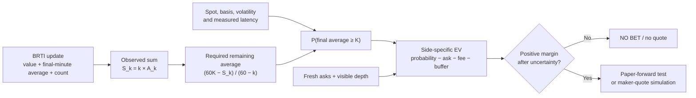
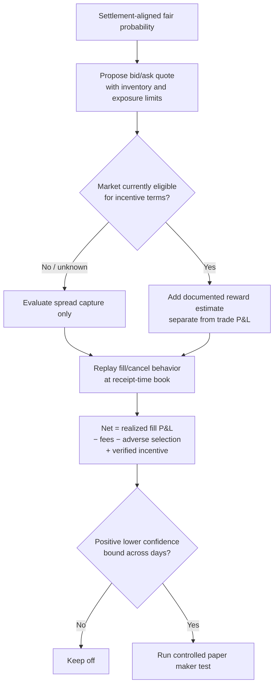
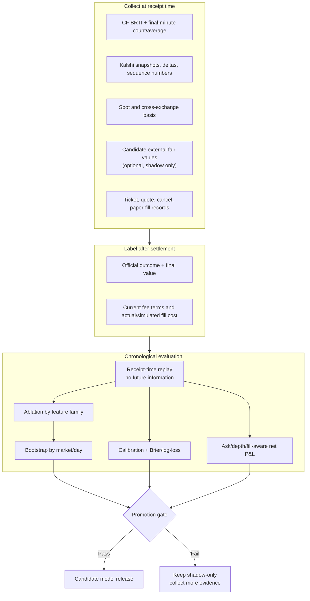
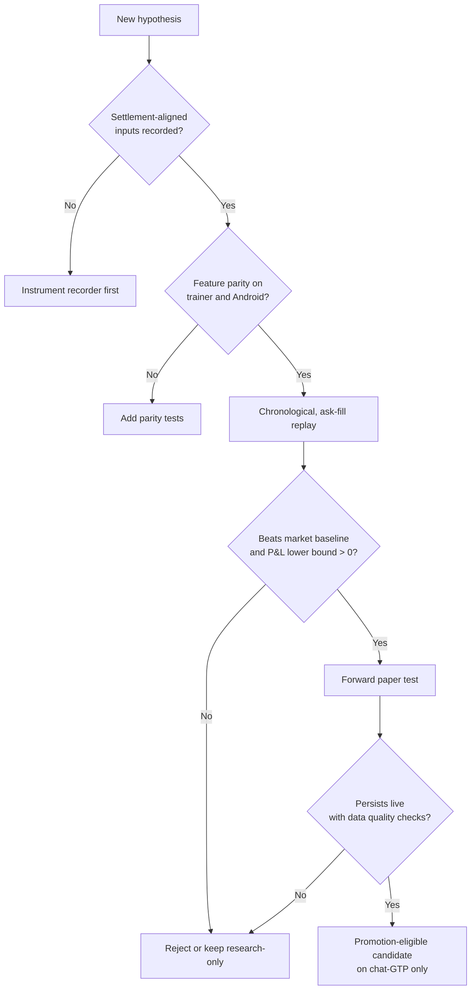

# KXBTC15M Structural Edge Research

## Purpose and evidence standard

This is a research playbook for possible structural advantages in Kalshi BTC 15-minute markets. It is **not** a claim that any strategy is profitable and it does not authorize automatic live trading.

The core rule is simple: a hypothesis earns a place in the app only after it beats a market-only baseline in a chronological replay using side-specific executable asks, fees, visible size, latency/slippage assumptions, and market/day-clustered uncertainty.

> [!warning] What the current app evidence says
> The repository's prior replay found that the market midpoint outperformed the app's blended forecast, and the historical app picks were net negative after realistic costs. Treat every idea below as a candidate for forward paper testing, not as an edge already found.

---

## 1. Verified market mechanics

| Fact | What it means for the app | Status |
|---|---|---|
| BTC crypto contracts settle from a 60-second average of CF Benchmarks RTI values. | A Coinbase/Binance last price is an imperfect proxy for the actual settlement variable. | Verified from Kalshi help and market rules. |
| `last_60s_windowed_average_15min` is available only in the final minute and reports its accumulated value and `window_size`. The start-boundary tick is excluded; the close tick is included. | The app can calculate how much of the final settlement average is already fixed and what the remaining observations must do to cross the strike. | Verified from Kalshi WebSocket documentation. |
| The market rule resolves YES when the final average is **at least** the target price. | Exact equality belongs to YES; use the exact documented inequality and rounding for the specific market. | Verified on published KXBTC15M market rules. |
| General taker fees are `round up(M × 0.07 × C × P × (1−P))`. Resting orders use the maker schedule, whose default multiplier is zero unless a series is specifically listed otherwise. | Price every candidate with the currently applicable side/series fee. Never assume a generic fee or maker multiplier stays unchanged. | Verified from Kalshi's current fee schedule; specific series terms must still be checked at trade time. |
| Liquidity incentives reward qualifying resting orders, scored from random once-per-second book snapshots; eligibility, target size, discount and reward vary by market/time period. | Incentives can be a separate research return stream, but should never be assumed for an ineligible market or used to justify adverse selection. | Verified from Kalshi's program description. |

### Settlement countdown mathematics

At `k` observed final-minute RTI seconds with running average `A_k`, the accumulated sum is:

```text
S_k = k × A_k
```

For strike `K`, the required average of the remaining `60 − k` observations for YES is:

```text
required_remaining_average = (60 × K − S_k) / (60 − k)
```

This is a **deterministic threshold**, not a probability. A model still has to estimate the distribution of the remaining index observations after accounting for volatility, the index-versus-exchange basis, remaining time, and feed delay.



---

## 2. Candidate edge families

### A. Settlement-index / final-minute average model

**Idea:** trade the final *average*, rather than a single-exchange spot print. A late spike may change the most recent price without changing enough of the already accumulated average to justify the book move.

**Why it is plausible:** Kalshi documents the settlement-aligned RTI feed, its final-minute running average, and its count. The app already records settlement-index rows and can export them for training.

**What must be measured:**

1. Receipt-time difference between a CF update and the Kalshi order-book response.
2. The relationship between remaining-average threshold distance and the realized outcome.
3. Whether a quote remains executable after the calculation; a transient displayed price is not a fill.
4. Quote behavior during missing, duplicated, or out-of-order source ticks.
5. Exact market rounding and equality handling.

**App research feature:** `FinalMinuteAverageModel` in shadow mode. It should write probability, required remaining average, feed age, count, side-specific asks, and a decision reason to the forward-test ledger. It should not control live orders until it clears the promotion gates.

### B. Maker economics and liquidity incentives

**Idea:** replace immediate crossing with resting limit orders and measure whether spread capture plus applicable venue incentives exceeds adverse-selection losses.

**Why it is plausible:** the official fee schedule differentiates immediate matches from resting orders; the liquidity program pays for qualifying resting depth even when it does not fill.

**Critical caveat:** a resting order tends to fill when the market is moving against it. A zero/low maker fee and a reward pool do not make a quote profitable. The system must model fill probability, adverse selection, cancellation delay, inventory imbalance, and the current market-specific fee/incentive terms.



**App research feature:** a maker simulator must be distinct from the current touch-size paper autopilot. It needs a queue/fill model, cancellation timestamp, inventory state, and an explicit label that the simulated fill is not a guaranteed real fill.

### C. Regime selection, not always-on prediction

**Idea:** most windows should be skipped. Trade/quote only when a predeclared context gives the settlement model or maker economics a chance to clear costs.

Candidate regime inputs:

- final-minute index count and required-remaining-average distance;
- spread, visible depth, book update rate, and stale-quote detection;
- realized/EWMA volatility and spot-to-BRTI basis;
- quarter-hour boundary behavior;
- scheduled macro/funding/liquidity windows;
- order-book sequence gaps or one-sided liquidity, which should force abstention rather than create a signal.

The research goal is not a colorful “regime score.” It is a measurable reduction in bad trades while preserving enough independent observations to test the remaining ones.

### D. Directional reversal and boundary-flow hypotheses

**Idea:** use a short-horizon mean-reversion/fade feature after a large, flow-driven move or around quarter-hour boundaries.

**Evidence status:** third-party academic/research leads supplied for this project describe short-horizon reversal and boundary effects. They are useful hypotheses, not production facts until replicated against the actual KXBTC15M settlement process, ask prices, and fees.

**Test design:**

1. Freeze the feature definition: prior move, lookback, sign, size threshold, and entry timestamp.
2. Evaluate it first as a probability correction to the market prior, not an unconditional side override.
3. Run ablations: market only; market + settlement-average features; market + reversal; combined model.
4. Require the combined model to improve on the simpler settlement model out of sample after executable costs.

### E. Cross-venue and options-implied fair value

**Idea:** use external venues/IBIT options as a *fair-value cross-check*, not a naïve arbitrage signal.

**Risks:** contract strikes, source indexes, settlement rules, tick timing, liquidity, and order fill probability can differ. A displayed price spread is not a lock unless both contracts settle on compatible definitions and both legs can be filled after all fees.

**Test design:** normalize every comparison to:

```text
same underlying + same strike convention + compatible expiry + settlement method
+ executable depth + both-leg fees + transfer/inventory/leg-fill risk
```

Only then can a divergence be recorded as a potential dislocation. The initial implementation should log it for analysis; it should not place paired live trades.

### F. Within-Kalshi consistency checks

**Idea:** scan related Kalshi markets for logical inconsistency, such as monotonicity violations across truly nested strike ladders.

**Caveat:** this is only valid when contract outcomes are genuinely nested and share compatible settlement terms. `YES + NO < 1` on the same binary should not be assumed; the app must use actual side-specific executable prices and the exchange's contract mechanics.

**App research feature:** `ContractConsistencyScanner`, first as a passive logger that records candidate violation, terms hash, book depth, fees, and the time to correction.

---

## 3. The research stack to build



### Minimum recorder schema

| Dataset | Minimum fields |
|---|---|
| CF index | index ID, source timestamp, receipt timestamp, raw value, final-minute running average, sample count, bounds, sequence |
| Kalshi book | market ticker, source/receipt timestamp, sequence, both bids/asks, visible size by level, snapshot/delta flag |
| Decision | model version, feature vector hash, probability, side-specific EV, skip/bet/quote reason, data-quality flags |
| Paper/maker simulation | requested size, simulated fill rules, fill/cancel time, queue/depth assumptions, fee, realized outcome |
| Settlement | official result, official final value, rule/version reference, settlement time |

---

## 4. Promotion scorecard for every hypothesis

| Gate | Required evidence |
|---|---|
| Data integrity | No future data in features; source/receipt timestamps present; book sequence gaps flagged; settlement source known |
| Comparable baseline | Market-only forecast and current abstention rule evaluated on exactly the same rows |
| Forecast quality | Better out-of-sample Brier and log-loss, plus at least as good calibration |
| Execution realism | Side-specific asks, fees, visible depth, latency, partial/unfilled order treatment—not midpoint fills |
| Statistical reliability | Whole market/day chronological separation and a positive lower confidence bound for P&L |
| Operational safety | Manifest/provenance, rollback, paper-forward monitoring, stale-input fail-closed behavior |



---

## 5. Implementation order for DipHunter GTP

1. **Finish data quality first.** Validate/update the current BRTI recorder and CSV export; add receipt timestamps, source timestamp ordering, sequence/gap counters, and book snapshots/deltas.
2. **Build a final-minute research feature.** Calculate and log the required remaining average, but leave it in shadow mode until it clears the scorecard.
3. **Add a maker simulator—not maker autopilot.** Estimate fills and adverse selection using recorded book history. The current unlimited-credit paper path is useful for signal throughput but does not establish maker fill quality.
4. **Add regime filters as abstention candidates.** Every filter must be evaluated by how much it improves net P&L confidence, not only hit rate.
5. **Run clean ablations.** Settlement math alone must beat market-only before adding reversal, cross-venue, options, or ladder features.
6. **Publish only gated models.** Use the existing `chat-GTP` model manifest, current strict promotion thresholds, and rollback behavior.

---

## 6. Source quality register

### Primary sources verified for this note

- [Kalshi: Crypto Markets](https://help.kalshi.com/en/articles/13823838-crypto-markets) — 60-second CF RTI averaging and API access.
- [Kalshi: CF Benchmarks Value Feed](https://docs.kalshi.com/websockets/cfbenchmarks-value) — final-minute running-average field, count, timing semantics, and authentication requirement.
- [Kalshi: current fee schedule](https://kalshi.com/docs/kalshi-fee-schedule.pdf) — taker/maker formulas and fee rounding.
- [Kalshi: Liquidity Incentive Program](https://help.kalshi.com/en/articles/13823851-liquidity-incentive-program) — eligibility, snapshot scoring, variable terms, and program risk.
- [Published KXBTC15M market-rule example](https://kalshi.com/markets/kx/m/kxbtc15m-26aug060615) — YES resolves when the final average is at least the target.

### Leads requiring independent replication before use

- The 6,298-window directional/maker study and its quoted performance numbers.
- Claimed retail late-spike mispricing frequency or volume statistics.
- Short-horizon crypto reversal and quarter-hour-boundary findings as applied to this exact settlement process.
- Cross-venue, options-implied, and ladder-dislocation statistics.
- Any assertion that a specific KXBTC15M window is liquidity-incentive eligible or has a particular maker multiplier at a future time.

The project should retain the supplied references in research notes, but the production model should rely on measurements reproduced from our own timestamped dataset.

---

## Bottom line

The strongest out-of-the-box direction is not a bigger black-box AI: it is **settlement-aware, execution-aware research**. Watch the same BRTI average that resolves the contract; estimate the remaining average honestly; price the actual ask, fee, and depth; and require every extra signal to earn its weight against the market baseline.

Maker economics, incentive programs, reversal, regime filters, cross-venue comparisons, and digital-option framing are valuable research branches. None should bypass the recorder, replay, forward-paper test, or promotion gate.
